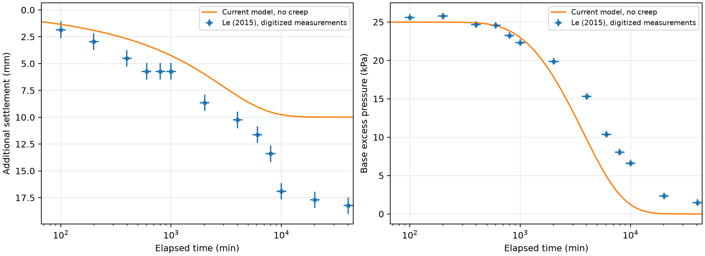

# 公開室内実験との比較

Le (2015)の大形Rowe cell試験で、沈下と底面過剰間隙水圧を同じ時点で比較しました。
**今回の条件と物性換算では、現モデルは両時系列を再現しませんでした。** 格子・時間刻みを細かくしても、この差は解消しません。
[Issue #32](https://github.com/Mr-Kondo/2D_MIKASA_CONSOLIDATION_THEORY/issues/32)の完了は、この比較手順の実施を指します。実地盤への適合性・設計精度の認定を意味しません。

## 出典と対象

Thu Minh Le (2015), *Analysing Consolidation Data to Optimise Elastic Visco-plastic Model Parameters for Soft Clay*, University of Technology Sydney博士論文。
[大学公開の本文PDF](https://opus.lib.uts.edu.au/bitstream/10453/34461/2/02whole.pdf)を使用しました。全332頁のうち、材料・試験条件・構成則の定義と対象図の掲載箇所を確認しました。論文全体を精査したとは扱いません。

| PDF頁（印刷頁） | 使用した情報 |
| --- | --- |
| 104（3-2） | 式(3.2)の自然対数に対する基準ひずみ勾配、`V = 1 + e0`の定義 |
| 160（4-12）、161（4-13） | Table 4.3の`λ/V = 0.1045`、Fig.4.10の`e0 = 3.165`、`k0 = 1e-6 m/min`、`Ck = 1.03` |
| 164〜170（4-16〜4-22） | KBS混合土、大形Rowe cell、上面排水・底面非排水、底面計測点A1、載荷条件 |
| 168（4-20） | Tables 4.4/4.5の基準厚140.5 mm、25→50 kPa、開始総ひずみ27.76%、保持39日 |
| 171（4-23） | Fig.4.16の25→50 kPa段階の青い実測ひずみ点 |
| 172（4-24） | Fig.4.17(a)の緑の実測A1底面水圧点 |

原著の赤・紫の曲線はEVPモデルの予測であり、比較の正解値には使いません。原著にはクリープ・緩和が含まれますが、現ソルバーには含まれません。
元PDF・図全体は再配布せず、出典を付した測定点の数値と、自分たちで計算した比較図・ログを保存します。CSVは著者の生データではなく、公開図から読み取った二次データです。

## 数値化と読取誤差

[出典・PDFのSHA-256・座標校正](../benchmarks/data/le_2015_source.json)を保存しています。
`extract_le.py`は同一PDFのベクトル描画から色とマーカー形状で実測点の中心を抽出し、凡例・別載荷段階・予測曲線を除きます。PDFの座標は左上原点、単位はpointです。

| 図 | 時間軸の左端→右端 | 縦軸の上端→下端 |
| --- | --- | --- |
| Fig.4.16 | x=168.18→511.32、0.1→100000 min | y=470.40→675.42、20→65 % |
| Fig.4.17(a) | x=106.20→445.44、0.1→100000 min | y=115.86→344.46、40→0 kPa |

時間は対数軸、縦軸は線形です。ひずみ29点・A1水圧14点を抽出しました。図と抽出した点群を照合し、対数軸・上下方向・単位の変換をテストしています。
保守的な図読取幅として座標に±2.5 point（ほぼマーカー半径）を与えると、時間は約÷1.107〜×1.107、沈下は±0.771 mm、水圧は±0.437 kPaです。
これは計測器の精度、統計的な信頼区間、物性・初期状態の不確かさを表すものではありません。

水圧の計測時点に、実測総ひずみをlog(time)上で線形補間しました。ひずみの前後点がない最後の水圧1点は除外し、**100〜40491 minの13時点**で比較しました。外挿はしません。

## モデルへの換算と仮定

基準厚`H0=0.1405 m`と開始総ひずみ`εi=0.2776`を、載荷時の状態と混同しないように換算しました。

```text
載荷時厚 H = H0 × (1 − εi) = 0.1014972 m
載荷時間隙比 ei = (1 + 3.165) × (1 − εi) − 1 = 2.008796
Cc = ln(10) × 0.1045 × (1 + 3.165) = 1.002182892
載荷時k = 1e-6 × 1440 × 10^((ei − 3.165)/1.03)
        = 0.000108601128 m/day
実測追加沈下[mm] = (実測総ひずみ[%]/100 − εi) × H0 × 1000
```

固体体積一定かつ初期ひずみが一様という仮定で、載荷時厚・間隙比を換算します。
原著のEVP基準線の勾配を`e-log10(σ')`の勾配へ換算して使いました。`Cc`は独立に測った圧縮指数ではありません。
基準線の切片と載荷履歴を移し替えた完全なEVP解析ではなく、現モデルを一段載荷条件で評価するための仮定です。LRC実測値に合わせた再較正は行っていません。

`nx=1`、上面排水・底面非排水、初期地表応力25 kPa、荷重増分25 kPaとしました。比重は対象箇所に値がないため**2.65を仮定**し、2.5・2.8の感度も計算しました。水の単位体積重量は9.81 kN/m³です。
原著の計算は自重を無視しますが、現モデルは自重と釣り合う初期状態を作ります。別途、`γw`と`k`をともに1e-6倍にし、`k/γw`を保持して自重を0へ近づけた数値的な極限も比較しました。この極限の値を実在する水・土の物性とは扱いません。

沈下は全セルの体積減少を積分した地表値、水圧は底面に最も近いセル中心の値を使います。底面水圧との位置の差は格子依存の確認に含めます。

## 結果と数値依存

基準は`nz=81`、刻み5 minです。[全結果JSON](evidence/le_2015_report.json)と[時点別CSV](evidence/le_2015_comparison.csv)を保存しました。

| 量 | RMSE（二乗平均平方根誤差） | 最大絶対誤差 |
| --- | ---: | ---: |
| 追加沈下 | 4.198 mm | 8.255 mm |
| 底面過剰間隙水圧 | 3.214 kPa | 5.594 kPa |



| 確認 | 比較点上の沈下の最大変化 | 水圧の最大変化 |
| --- | ---: | ---: |
| `nz=41→81`、刻み20 min | 0.00597 mm | 0.00228 kPa |
| 刻み10→5 min、`nz=81` | 0.00815 mm | 0.01076 kPa |
| 比重2.65→2.5または2.8、`nz=41`・20 min | 0.00554 mm以下 | 0.00411 kPa以下 |
| 自重を0へ近づける極限、`nz=41`・20 min | 0.191 mm | 0.158 kPa |

さらに`nz=21`と刻み20 minの結果もJSONに記録しています。この確認範囲では、観測との差は格子・刻み・比重の変更より大きいままでした。すべての物性や初期状態の不確かさを検査したという意味ではありません。

## 解釈と限界

この物性換算では、モデルは後半の沈下を小さく、水圧を早く消散させる傾向になりました。
現モデルが扱わないクリープ・緩和は原著との重要な違いです。ただし、差の原因をクリープだけと断定することはできません。基準線の換算、一様な初期状態、載荷履歴、物性同定、図読取にも仮定があります。

実測比較は「一致しなかった」という結果も含めて実施しました。数値差を消すための物性調整、クリッピング、収束判定の緩和は行っていません。**この室内試験の比較をもって、実地盤の設計に使えるモデルと認定しません。**

## 再現

リポジトリのルートで実行します。通常の比較にはNumPy・Matplotlib以外の依存を追加しません。

```bash
uv run --locked python benchmarks/experimental.py
uv run --locked python -m unittest -v
```

図とJSON・CSVは`outputs/experimental/`に出力し、同名ファイルを上書きします。刻みを揃えた公開APIの反復実行を使い、計算式を別実装へ複製しません。
図の数値化をやり直す場合だけ、本文PDFを別途取得し、Python 3.13で実行します。PyMuPDFはこの抽出作業用の一時依存で、通常のパッケージ依存には含めません。

```bash
uv run --python 3.13 --no-project --with pymupdf==1.26.7 python benchmarks/extract_le.py PATH_TO_PDF
```

元PDFのハッシュが一致しなければ抽出を停止します。原著の図が変わった場合に、色・形状・校正値を検査せずにデータを上書きしないためです。
