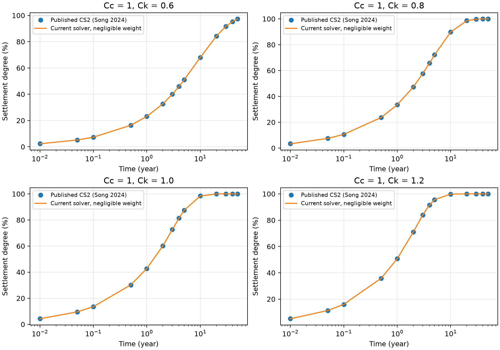
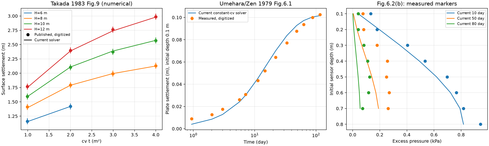
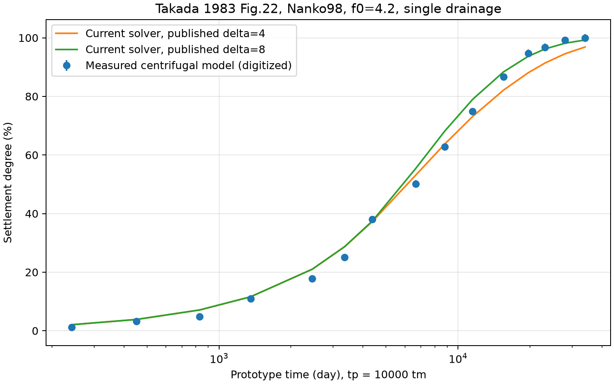

# 論文ごとの計算比較

検証を、**数値解法の照合**と**実験への適用範囲の確認**に分けます。
クリープを含む試験と、クリープを扱わない現モデルとの差だけでは、実装の誤りや三笠理論の不成立を判断できません。
Le (2015)の探索的比較は残し、計算の正否を判定する主要な基準としては使いません。

## 再調査とIssue

2026-10-22に、三笠理論を直接用いる既往研究、有限ひずみ圧密の解析解、検証用の数値ベンチマークを再調査しました。
論文の年代や一致の有無ではなく、構成則・初期状態・境界条件・載荷履歴と、比較値の取得可能性で選びます。

| 論文・Issue | 用途 | 確認した範囲と現在の制約 |
| --- | --- | --- |
| [梅原・善 (1979)](https://www.pari.go.jp/PDF/vol018-no01-02.pdf)・[#40](https://github.com/Mr-Kondo/2D_MIKASA_CONSOLIDATION_THEORY/issues/40) | 自重圧密の実測比較 | §6、Table 6.1、Figs.6.1/6.2を確認。一定cvの比較用モデルで実測沈下13点・水圧22点を比較。上部未圧密層の扱いは高田の近似を採用し、原著の計算法と完全同一とは扱わない。 |
| [小林 (1982)](https://www.pari.go.jp/PDF/vol021-no01-03.pdf)・[#41](https://github.com/Mr-Kondo/2D_MIKASA_CONSOLIDATION_THEORY/issues/41) | 三笠式の既往計算との照合 | §3.4、Figs.3.4–3.6、参考文献10/11を確認。Fig.3.6は両面排水・段階載荷。初期厚・間隙比などが当該条件図に記載されず、参照先11は「未発表資料」。再計算未実施。 |
| [Morris (2002)](https://doi.org/10.1061/(ASCE)1090-0241(2002)128:4(319))・[#42](https://github.com/Mr-Kondo/2D_MIKASA_CONSOLIDATION_THEORY/issues/42) | 有限ひずみ解析解との照合 | 出版社抄録まで確認。本文・式・数表は未取得。通常のTerzaghi解との照合を、この論文の有限ひずみ解析解の再現と呼ばない。 |
| [Fox・Pu (2015)](https://doi.org/10.1061/(ASCE)GT.1943-5606.0001357)・[#43](https://github.com/Mr-Kondo/2D_MIKASA_CONSOLIDATION_THEORY/issues/43) | 数値ベンチマーク2ケース | 出版社・著者所属大学の概要を確認。本文・数表は未取得。大学リポジトリのDownloadも取得できず。 |
| [Pu・Song・Fox (2018)](https://doi.org/10.1061/(ASCE)GT.1943-5606.0001872)・[#44](https://github.com/Mr-Kondo/2D_MIKASA_CONSOLIDATION_THEORY/issues/44) | 自重圧密の数値ベンチマーク | 出版社・著者所属大学の概要を確認。原著本文・数表は未取得。後続論文の再掲条件を原著の直接確認として扱わない。 |
| [Songら (2024)](https://doi.org/10.1002/nag.3843)・[#45](https://github.com/Mr-Kondo/2D_MIKASA_CONSOLIDATION_THEORY/issues/45) | 同じ圧縮則・透水則のCS2数値解との照合 | 公開本文の式(10)/(11)、§4、Table 1/2を確認。比較計算を実施。詳細は下記。 |
| [高田 (1983)](https://doi.org/10.2208/jscej1969.1983.334_113)・[#46](https://github.com/Mr-Kondo/2D_MIKASA_CONSOLIDATION_THEORY/issues/46) | 三笠式の計算例・遠心模型試験との比較 | 公開本文9頁を取得・OCR。§2は時間依存性なし、浮力を考慮した自重、f-logp/f-logcv則。§3の境界近似と§4の一定cv条件を対応させ、Fig.9の4層厚・14点と終局値を比較。§6のFig.22片面排水の遠心模型実測15点も比較。 |

Morris (2005, [DOI](https://doi.org/10.1002/nag.407))は未圧密層への上載荷重を扱う関連候補ですが、Morris (2002)と混同せず、本文取得前の代替採用は保留しました。
SIDERE (2002, [著者所属大学の書誌](https://research.tudelft.nl/en/publications/sidere-numerical-prediction-of-large-strain-consolidation/))も検索しましたが、今回は構成則が同じで数表を直接取得できたSongらを先行しました。

### 梅原・善の条件を確認して分かったこと

PDF29–31頁（印刷頁60–62）の試験は、厚さ80 cm、初期間隙比7.849、上面排水・底面非排水、Cc=1.75、cv=0.025 cm²/minです。
圧縮則は`1+e = 3.8 − 1.75 log10(σ′[kgf/cm²])`で、沈下の測定点は表面ではなく**初期深さ10 cm**です。水圧ピックアップも土とともに移動します。

原著は沈下の一致を報告する一方、水圧分布は10日にはほぼ一致するが、50日・80日には一致がよくないと明記しています。
著者は計測管・ポーラスストーンの遅れを原因と推定していますが、その推定を独立に確認したわけではありません。
したがって「沈下・水圧とも全期間よく一致する試験」とは紹介しません。

一定cvを実現する透水則は、`a_v = Cc/(ln(10) σ′)`とすると`k = cv γw a_v/(1+e)`です。
通常の一定Ckによるe-logk則とは一致しないため、比較用の`SelfWeightColumn`でこの透水則と一様な初期スラリーを与えます。Newton反復・有限体積法・時間積分は製品ソルバーを共有し、独立の別解法へ置き換えてはいません。

### 小林の比較ケースを確認して分かったこと

PDF12–13頁（印刷頁67–68）のFig.3.4はDavis・Raymond (1965)の解析解との比較です。
Fig.3.6は三笠の計算との比較で、Cc=1.0、cv=5.5e-2 cm²/min、両面排水、段階載荷です。
現実装の底面非排水・一段載荷・一定Ckとは条件が異なります。初期層厚や間隙比を図の沈下曲線から逆算して合わせることはしません。

### 自重の定義の照合で見つかった差

高田 (1983) §2は浮力を考慮した水中単位体積重量を使います。
v0.6.2までの実装は飽和土の全重量を有効応力へ積分し、全応力−有効応力を過剰水圧としていたため、静水圧分の差し引きが対応していませんでした。
独立した確認例で、Gs=1、深さ1 m、地表有効応力20 kPa、無載荷とすると、浮力差が0なので全深さで有効応力20 kPaとなるはずですが、修正前は底側セルで29.7508 kPaとなりました。
この具体的な差を[#46の監査記録](https://github.com/Mr-Kondo/2D_MIKASA_CONSOLIDATION_THEORY/issues/46)に残しています。
v0.7.0で`u = 全応力 − 静水圧 − 有効応力`、有効自重`γw(Gs−1)`へ修正しました。全応力の出力は飽和重量を保持します。Gs=1の反例テストは修正前に失敗し、修正後に成功しました。鉛直Newton行列も残差の数値微分と照合しています。
下記の自重を無視したSong比較だけでは、この自重項の妥当性を証明しません。Le (2015)との差のすべてが、この項だけで説明できるとも確認していません。

## Songら (2024)：公開CS2数表との比較

この論文を選んだ理由は、クリープを含まない計算で、現実装と同じe-logσ′則・e-logk則を使い、CS2の比較値が表にあるためです。
原著の簡便法の曲線ではなく、**Table 1のV-Cv列（CS2数値解）**を参照します。実測データではありません。
Table 2のCS2列に同じ56値が掲載されており、PDF9頁を表示して転記を照合しました。
[転記CSV](../benchmarks/data/song_2024_table1.csv)と[出典・PDFハッシュ](../benchmarks/data/song_2024_source.json)を保存しています。

| 条件 | 値 |
| --- | --- |
| 初期厚・間隙比・有効応力 | 10 m、2.7、20 kPa |
| 初期透水係数 | 2e-8 m/s = 0.001728 m/day |
| 圧縮指数・透水指数 | Cc=1、Ck=0.6/0.8/1.0/1.2 |
| 荷重・排水 | 瞬間荷重400 kPa、上面排水・底面非排水 |
| 比較時点 | 0.01〜50年の14時点 |
| 比較量 | 沈下/最終沈下×100 [%]。水圧積分の消散率とは異なる。 |

原著が示す最終沈下3.574 mは、`10/(1+2.7) × log10((20+400)/20) = 3.57356566 m`と対応します。
一様な初期有効応力とこの最終沈下に対応する**自重を無視する極限**を使用しました。
現実装ではkとγwを同じ1e-8倍にし、k/γwと排水の時間尺度を保ちます。実在する水・土の物性値とは扱いません。
1e-6倍との結果の差も記録します。この比較は、現実装の自重項・二次元拡張の検証にはなりません。

原著の確認箇所で年の日数とγwの数値を確認できなかったため、**1年=365.25日、γw=9.81 kN/m³を比較側の仮定**としました。
表の丸め幅は±0.0005ポイントで、物性・単位換算の不確かさを表すものではありません。
差を消すための物性同定は行っていません。

### 計算結果

641格子・刻み倍率4を比較値としました。14時点それぞれの差を、圧密度のパーセントポイントで示します。
例えば圧密度50.00%と50.02%の差は0.02ポイントです。

| Ck | RMSE [ポイント] | 最大絶対差 [ポイント] |
| --- | ---: | ---: |
| 0.6 | 0.00767 | 0.02206 |
| 0.8 | 0.00591 | 0.00946 |
| 1.0 | 0.00837 | 0.01683 |
| 1.2 | 0.01093 | 0.02319 |



[時点別CSV](evidence/song_2024_comparison.csv)と[全結果JSON](evidence/song_2024_report.json)に数値と実行環境を保存しました。
同じ刻み倍率2で321→641格子にした最大変化は、Ck順に0.09210/0.02431/0.01061/0.00572ポイントです。
641格子で刻み倍率2→4にした最大変化は、0.01282/0.01981/0.02707/0.03418ポイントでした。
粗い格子では、とくに初期の小さい圧密度を十分解像できず、差が大きくなります。全格子の結果をJSONに残しています。

自重抑制倍率1e-6と1e-8の差は、81格子・刻み倍率1で0.000077ポイント以下でした。
同じ解像度で年を365日に変更した影響は0.0222ポイント以下、γwを10 kN/m³に変更した時間尺度の影響は0.622ポイント以下です。
この感度は比較条件の不確かさであり、原著の正確な年換算・γwを同定したものではありません。
したがって「掲載精度まで完全一致した」とは言わず、**明記した仮定の下で、56値の最大差0.0232ポイントで照合できた**と結論づけます。

### 再現手順

```bash
uv run --locked python benchmarks/song_2024.py
uv run --locked python -m unittest -v
```

`outputs/song_2024/`にJSON・CSV・図を出力します。
既存の`FiniteStrainConsolidation.run_simulation`を1刻みずつ呼び、各観測時刻で止めます。比較スクリプトは`nt=1`のまま`dt`と`total_time`を同じ刻みに更新します。
刻みは`min(残り時間, 10/refinement日, max(経過日数,0.1)×0.02/refinement)`です。
格子41/81/161/321/641、刻み倍率1/2/4を記録し、格子差は321→641（倍率2）、刻み差は倍率2→4（641格子）で比較します。

### 判断の範囲

この比較が検証するのは、一様初期応力・片面排水・瞬間上載荷重・自重を無視する条件での、**一次元の沈下に基づく圧密度**です。
参照表にない水圧の時系列、実測への適合、自重圧密、二次元の水平流れを検証済みとはしません。
未取得資料・未対応条件を残した論文のIssueは開いたまま追跡します。

## 高田 (1983)・梅原・善 (1979)：自重圧密の比較結果（v0.7.0）

[比較スクリプト](../benchmarks/self_weight_comparison.py)を`uv run --locked python benchmarks/self_weight_comparison.py`で実行します。
[共有する比較用モデル](../benchmarks/self_weight.py)は一定cvの透水則を使い、上面排水・底面非排水、一様な初期体積比を与えます。
通常の公開APIは自重平衡からの一段載荷のままです。比較に使う初期化・物性則を公開APIの既定値へ混ぜていません。

### 原著条件と数値化

高田のPDF3–4頁（印刷頁115–116）§3、Fig.2、Table 1、§4、Fig.9を目視確認しました。
体積比f0=5、Cc=0.8、初期降伏応力0.01 tf/m²、層厚6/8/10/12 mを採用します。
水の重量1 tf/m³、Table 1の上部厚の関係からGs=2.65を使います。
cvの実数を同定せず、原図の横軸`cv t [m²]`に合わせてcv=1 m²/dayと正規化します。

高田§3に従い、圧縮しない上部厚`cap = σ0 f0 / (γw(Gs−1))`を除き、活動層上端に初期降伏応力を与えます。
高田ではcap=0.03030 mです。梅原・善にもこの近似を適用するとcap=0.07250 mとなります。
**後者は比較側の仮定で、梅原・善の原著計算法と完全同一と確認できた境界処理ではありません。**
活動層の厚さは全厚からcapを引きます。初期の測点深さz0を`ζ=(z0−cap)/f0`へ換算し、同じ土粒子位置を追跡します。
梅原・善のGs=2.59はPDF15頁Table 4.1、その他の値はTable 6.1と§6.3です。初期降伏応力0.127755 kPaは記載の圧縮則とf0=8.849から換算しました。

[高田の出典・座標校正](../benchmarks/data/takada_1983_source.json)と[読取座標CSV](../benchmarks/data/takada_1983_settlement.csv)、
[梅原・善の出典・座標校正](../benchmarks/data/umehara_1979_source.json)、[沈下座標](../benchmarks/data/umehara_1979_settlement.csv)・[水圧座標](../benchmarks/data/umehara_1979_pressure.csv)を保存しています。
原著の予測曲線を実測として採用せず、梅原・善では実測マーカー、高田では数値計算曲線を読み取りました。
図の画素読取幅は、高田が縦±3 px（沈下±0.05195 m）・横±4 px（cv t ±0.06838 m²）、梅原・善が±2.5 px（沈下±0.794 mm、水圧±0.00577 kPa、時間÷/×1.0293）です。
これは読取の幅であり、実験計器の精度や統計的信頼区間ではありません。

### 結果と解釈

321格子・刻み倍率2での結果です。格子81/161/321と、321格子での倍率1→2も保存しています。

| 比較 | 点数 | RMSE | 最大絶対差 | 格子161→321の最大変化 | 刻み半減の最大変化 |
| --- | ---: | ---: | ---: | ---: | ---: |
| 高田・表面沈下 | 14 | 0.0100 m | 0.0226 m | 0.000625 m | 0.00459 m |
| 梅原・善・沈下板 | 13 | 3.92 mm | 6.50 mm | 0.0249 mm | 0.140 mm |
| 梅原・善・10日水圧 | 8 | 0.0689 kPa | 0.1250 kPa | 0.00000276 kPa | 0.000785 kPa |
| 梅原・善・50日水圧 | 7 | 0.0995 kPa | 0.1508 kPa | 0.00000447 kPa | 0.00234 kPa |
| 梅原・善・80日水圧 | 7 | 0.0604 kPa | 0.0842 kPa | 0.00000360 kPa | 0.00171 kPa |



高田の終局沈下ラベル1.79/2.54/3.33/4.15 mに対し、同じ構成則の釣合いを積分した値は1.78998/2.54586/3.33686/4.15584 mです。
0.01 m単位の原図表示に対して差は0.006 m未満です。過渡14点も今回の読取幅内で整合します。ただし粗い図から高精度の一致までは主張できません。
この一定cv比較は遠心模型試験や両面排水、二次元流れの検証にはなりません。遠心模型試験は下記で別に比較します。

梅原・善では沈下の傾向を再現しますが、今回の読取幅以内で一致したとは言えません。
50日・80日の水圧差は原著自身の記述とも整合する一方、今回の10日水圧にも読取幅以上の差があります。
原著の計算法との差、初期スラリーの投入時間、上部層の近似、計測の影響を切り分けられていないため、差の原因を一つに断定しません。
境界の近似を含むこの実測比較だけで、三笠理論や製品ソルバー全体が誤りとも、実地盤に十分な精度とも判定できません。

[全条件・数値依存・同時点沈下のJSON](evidence/self_weight_report.json)、
[高田の時点別CSV](evidence/self_weight_takada_1983.csv)、
[梅原・善の沈下CSV](evidence/self_weight_umehara_1979_settlement.csv)・[水圧CSV](evidence/self_weight_umehara_1979_pressure.csv)を保存しました。
水圧測定日の沈下は実測点間を対数時間で補間し、外挿せず、10/50/80日の計算沈下と並べています。補間値を直接観測と混同しません。
刻みは`min(残り時間, max(経過日数,0.0001)×0.02/refinement, 活動層厚²/(20 cv refinement))`です。
物性を曲線へ合わせる調整は行っていません。

### 高田§6：遠心模型試験の追加比較

[専用スクリプト](../benchmarks/takada_centrifuge.py)を`uv run --locked python benchmarks/takada_centrifuge.py`で実行します。
PDF5頁の式(26)、7頁のTable 3と§6、8頁のTable 4・Fig.22を目視確認し、南港98・f0=4.2・片面排水の実測マーカー15点を読み取りました。
模型厚0.1 m、100gから、原著式(28)/(29)に従って原型厚10 m、原型時間tp=10000 tmへ換算します。
原図の`t [10⁴ min]`は原型時間です。Cc=0.71、Gs=2.67、cv0=3.2e-4 m²/day、`f=3.22−0.71 log10(p[tf/m²])`です。
初期降伏応力は初期fから換算し、上部未圧密層を§3と同様に除きます。

原著の2条件δ=4/8を両方使い、`Ccv=(f0−ff)/log10(δ)`、`cv=cv0×10^((f0−f)/Ccv)`を与えます。
ffは原著指定どおり底面終局応力での体積比です。比較用モデルの透水則とその微分にこの変化を反映し、製品の有限体積ソルバーを共有しています。
δを結果へ合わせて調整したり、一致のよい方だけを掲載したりしていません。

| 掲載条件 | 321格子・倍率2のRMSE [ポイント] | 最大絶対差 [ポイント] | 格子161→321の最大変化 | 刻み半減の最大変化 |
| --- | ---: | ---: | ---: | ---: |
| δ=4 | 3.35 | 6.69 | 0.00628 | 0.170 |
| δ=8 | 2.69 | 5.44 | 0.0126 | 0.188 |



読取幅は±3 px、圧密度±1.215ポイント、時間÷/×1.0456です。実測との差はこの読取幅より大きく、掲載条件で完全一致したとは言えません。
また**原著のcv0自体がこの試験の初期沈下速度から求められている**ため、独立な実験への予測精度を立証する比較ではありません。
原著の校正を引き継いだ再計算であり、残差だけで理論の可否を判断しません。
Fig.22の両面排水、f0=4.98/4.0、別の圧密度で停止したFig.25–29の体積比等時線は今回の対象に含めていません。
選定した実測曲線には水圧時系列が掲載されていないため、水圧の実測照合とも扱いません。
[読取座標CSV](../benchmarks/data/takada_1983_centrifuge.csv)、[時点別比較CSV](evidence/self_weight_centrifuge_comparison.csv)、[物性・数値依存JSON](evidence/self_weight_centrifuge_report.json)を保存しました。
