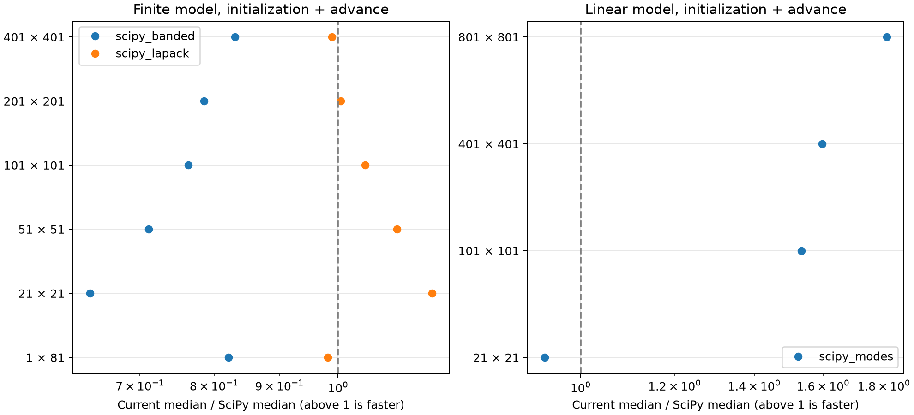

# SciPy導入効果の検証（2026-10-23）

## 結果

SciPyは現在の必須依存・計算本体では使っていません。インストールだけでは、既存コードの呼び出し先は変わりません。
既存の一部をSciPyへ差し替える実験では、**線形モデルの初期化が速くなり、有限ひずみモデルの効果は条件によって異なりました。今回の実解析では精度向上を確認できませんでした。**
公開モデルのAPI・物理式・既定のNumPy計算は維持し、比較コードだけにSciPyを使います。

## 比較方法

- Apple M5、メモリ32 GB、macOS arm64、Python 3.13.5、NumPy 2.5.4、SciPy 1.18.1。NumPy/SciPyのBLASは両方Accelerateです。
- v0.7.0の本体（基準コミット`4e7f45c`）を使用し、全方式をCPUの倍精度で計算しました。格子・荷重・刻み・Newton収束条件を変更していません。
- 有限ひずみモデルの純Python/NumPy Thomas法を、`solve_banded`のバッチ処理、または列ごとのLAPACK `dgtsv`へ置換しました。後者も配列の有限値とLAPACKの終了状態を検査します。入力配列は上書きしません。
- 線形モデルの`numpy.linalg.eigh`を、同じ対称三重対角行列の`scipy.linalg.eigh_tridiagonal`へ置換しました。モードごとの時間発展・境界条件は共通です。
- 各条件・方式の初回を別記し、その後は実行順を巡回させて各5回測定した中央値を使います。配列の組み替え・検査を含む初期化と計算の合計時間です。Python起動、SciPyのimport、描画・ファイル保存は含みません。
- 初回の間隙比・水圧・変位を既存版と`atol=rtol=1e-8`で照合し、有限ひずみでは時間刻みの自動分割数も照合しました。

本実験の差込はスクリプト内の一時的なものです。SciPyを選ぶ公開APIや、自動的にSciPyへ切り替える仕組みを追加したものではありません。

## 有限ひずみモデルの速度

単位は秒、初期化＋計算の中央値です。倍率は既存版の時間÷SciPy版の時間なので、1より大きければ高速です。
格子間で期間が異なるため、同じ行の方式間で比較します。

| nx×nz | 期間[日] / 刻み[日] | 既存版 | solve_banded | dgtsv | dgtsvの倍率 |
| --- | --- | ---: | ---: | ---: | ---: |
| 1×81 | 3650 / 5 | 0.06997 | 0.08523 | 0.07127 | 0.98 |
| 21×21 | 3650 / 5 | 2.97827 | 4.65533 | 2.51462 | 1.18 |
| 51×51 | 0.02 / 0.001 | 0.04431 | 0.06230 | 0.03984 | 1.11 |
| 101×101 | 0.02 / 0.001 | 0.19258 | 0.25208 | 0.18346 | 1.05 |
| 201×201 | 0.02 / 0.001 | 1.29923 | 1.65371 | 1.29268 | 1.01 |
| 401×401 | 0.005 / 0.001 | 5.26378 | 6.33720 | 5.32250 | 0.99 |

`solve_banded`への単純置換は今回の全条件で遅くなりました。
`dgtsv`の既定21×21では約1.18倍、時間にすると約0.464秒・15.6%の短縮です。201/401格子はほぼ同等でした。
大きい格子ほど必ず効果が増す結果ではありません。詳細な処理別プロファイルは測定していないため、遅延の原因を配列変換など一つに断定しません。

## 線形モデルの速度

いずれも3650日・指定刻み5日で、内部の刻み調整とモード時間発展は両方式で同じです。

| nx×nz | 既存版[秒] | eigh_tridiagonal[秒] | 倍率 |
| --- | ---: | ---: | ---: |
| 21×21 | 0.000110 | 0.000118 | 0.93 |
| 101×101 | 0.001331 | 0.000867 | 1.53 |
| 401×401 | 0.018109 | 0.011336 | 1.60 |
| 801×801 | 0.087153 | 0.048167 | 1.81 |

801×801の初期化中央値は0.076424→0.037474秒、初期化後の計算は0.010709→0.010693秒です。
高速化は主に固有値計算を含む初期化に現れ、初期化済みモデルを繰り返し進める処理はほぼ変わりません。
小さい格子では追加呼び出しの利点がなく、SciPyのimport時間も除外しているため、上表を短いスクリプト全体の高速化率とは扱いません。



## 精度・頑健性

今回の有限ひずみ6条件では、既存版とSciPy版の最終の間隙比・水圧・沈下の差は保存配列上で0でした。
線形モデルの通常計算も、長期のほぼ消散した水圧以外に差はなく、変位の差は0でした。これは列挙した条件の結果であり、常にビット単位で一致する保証ではありません。

さらに独立した基準で確認しました。

| 確認 | 結果 |
| --- | --- |
| 1セル、2セル、7×5、101×3の方程式 | 密行列による独立組立・解と一致。最大の規格化残差は約1.1e-16以下 |
| 線形モデルの解析的な拡散固有モード | 最大水圧誤差は両方式とも約0.0004782072 kPa。誤差値の方式間差は約1.6e-13 kPa |
| 有限ひずみの小ひずみ極限、T=0.4 | 下表。SciPyによる解析解との差の改善なし |

規格化残差は`||Ax−b||∞/(||A||∞||x||∞+||b||∞)`です。小さい残差だけで物理モデルの妥当性を証明したとは扱いません。
小ひずみ比較ではH=1 m、e0=1、Cc=0.005、Ck=0.05、初期有効応力1e6 kPa、荷重1 kPa、cv=4 m²/dayに対応する透水係数を使います。
大きい初期応力と微小荷重は解析解との対応を見る数値条件で、実地盤の物性とは扱いません。

| nz / 刻み[日] | Terzaghi解析解との差[ポイント]：既存版 | solve_banded | dgtsv |
| --- | ---: | ---: | ---: |
| 21 / 0.001 | −0.175016 | −0.175016 | −0.175016 |
| 41 / 0.00025 | −0.044081 | −0.044081 | −0.044081 |
| 81 / 0.0000625 | −0.010969 | −0.010969 | −0.010969 |

この表は格子と時間刻みを同時に細かくした比較です。両者それぞれの寄与を分離した実験ではありません。
今回の精度改善はライブラリの変更ではなく、離散化の細分化で得られました。

行交換の効果を確認する人工例として、`A=[[1e-20,1],[1,1]]`、`b=[1,2]`も計算しました。
80桁のDecimalによる参照解に対し、行交換なしの既存Thomas法の最大絶対誤差は1、SciPy両方式は倍精度参照値との差0でした。
最初の対角が極小の非対角優位な例であり、今回の圧密計算でこの不安定性が起きたとは確認していません。これを通常の実解析の精度向上と混同しません。
特異行列・非有限値で明示的に失敗することと、入力配列を変更しないことも自己検証しています。

## 再現と保存物

```bash
uv run --locked --with scipy==1.18.1 python benchmarks/scipy_evaluation.py
uv run --locked --with scipy==1.18.1 python benchmarks/scipy_evaluation.py --check
```

1行目は`outputs/scipy/report.json`と`comparison.png`を生成します。同名ファイルは上書きします。
2行目はアダプターの自己検証と、既存の46テストを3方式の差込状態で実行します。
各方式で43成功・GPU実機専用3件skipでした。別Pythonを起動するテストの子プロセスへは一時差込を伝播させず、従来の本体で実行します。
CIではPython 3.13のUbuntu・macOS・Windowsでこの検証を実行します。CIの正しさの確認を、他OSでの速度測定とは扱いません。

[全反復・条件・環境・誤差のJSON](evidence/scipy_report.json)、[検証ログ](evidence/scipy_checks.txt)、[再現スクリプト](../benchmarks/scipy_evaluation.py)を保存しました。
SciPyは一時環境へ追加するだけで、`pyproject.toml`の必須依存・`uv.lock`の依存パッケージへ追加しません。
この測定に伴う版番号の更新を除き、本体ソルバーは変更していません。

## 判断と未検証範囲

精度向上だけを目的として、現時点でSciPyを必須化する根拠は得られませんでした。
線形モデルの大きい格子の初期化と、有限ひずみの一部条件には速度面の利点がありますが、全体の自動置換は採用していません。
単一ホストの5反復の結果で、CPU・BLAS・SciPy版・実装の差で結果は変わり得ます。反復範囲はJSONに残しますが、統計的な信頼区間は算出していません。
SciPyの別アルゴリズムによる時間積分・非線形反復の置換、GPUでの性能、他OSの速度、importを含む起動時間、実地盤への適用精度は対象外です。
停止中の論文別Issueの自動継続は再開していません。

## 参照した公式API

- [SciPy solve_banded](https://docs.scipy.org/doc/scipy/reference/generated/scipy.linalg.solve_banded.html)
- [SciPy LAPACK dgtsv](https://docs.scipy.org/doc/scipy/reference/generated/scipy.linalg.lapack.dgtsv.html)
- [SciPy eigh_tridiagonal](https://docs.scipy.org/doc/scipy/reference/generated/scipy.linalg.eigh_tridiagonal.html)
